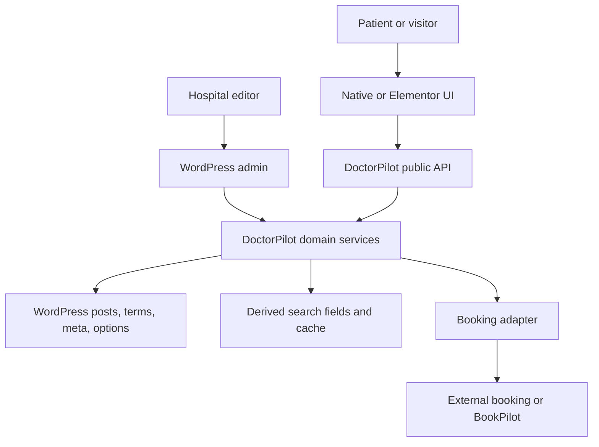
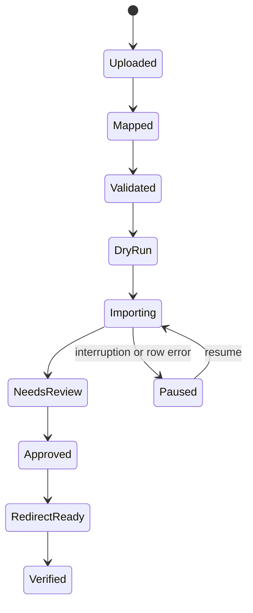

# 03 — Architecture

## 1. System context

DoctorPilot is a WordPress plugin with an optional Pro add-on. WordPress owns persistence and lifecycle; DoctorPilot owns the doctor domain model, validation, discovery, and public serializers. Elementor and themes render DoctorPilot data but never become its source of truth. Booking providers receive a resolved call to action but do not own profile data.

## 2. Architectural principles

1. **One canonical data model.** Posts, taxonomy relationships, and registered metadata are authoritative.
2. **Presentation is replaceable.** Native templates, shortcodes, Elementor widgets, and future blocks consume the same view models.
3. **Public output is allowlisted.** Storage schema and public REST schema are deliberately different.
4. **Derived state is rebuildable.** Search documents, completeness scores, caches, and aggregates can be regenerated from canonical data.
5. **Dependencies point inward.** Transport, UI, and providers call domain services; domain services do not depend on Elementor or HTTP.
6. **Free remains complete.** Pro extends through registered interfaces and hooks, not parallel implementations.
7. **Healthcare claims are curated.** The system never invents symptom, diagnosis, treatment, or availability relationships.
8. **Lifecycle operations are reversible where possible.** Deactivation preserves data; migrations are versioned and idempotent.

## 3. Logical layers

| Layer | Responsibilities | Must not |
|---|---|---|
| Domain | Field registry, invariants, profile completeness, clinical relationships, ranking rules | Read request globals or render HTML |
| Application | Search, doctor read/write services, migration jobs, redirect validation, booking resolution | Depend on Elementor classes |
| Infrastructure | WordPress repositories, cache, cron, tables, HTTP/provider clients | Decide business policy |
| Transport | REST controllers, admin form handlers, CLI commands | Query storage directly around services |
| Presentation | Native templates, shortcodes, Elementor widgets, admin views | Define or duplicate field storage |
| Integration | Elementor, SEO owner, BookPilot/external booking adapters | Expose secrets or bypass validation |

## 4. Package and component boundaries

| Component (`includes/`) | Responsibility |
|---|---|
| `Domain/Doctor/` | Doctor entity rules, field registry, completeness, view-model contracts |
| `Domain/Search/` | Search request model, normalization, scoring, facet contracts |
| `PostTypes/` | Register the prefixed doctor post type and the library CPTs plus their capabilities |
| `Taxonomies/` | Register prefixed taxonomies and term metadata |
| `Library/` | Global library CPT schemas, `DoctorContentResolver`, reverse-reference index, dedupe keys, and the authenticated `library/search` controller wiring |
| `Fields/` | WordPress meta registration, serializers, sanitizers, validators |
| `Application/Doctors/` | Doctor commands/queries used by admin, REST, and rendering |
| `Application/Search/` | Candidate query, scoring, facets, suggestions, no-result recommendations |
| `Rest/` | Public REST controllers and any authenticated admin controllers |
| `Admin/` | Editor, settings, notices, permissions, migration screens |
| `Frontend/` | Native templates, shortcodes, assets, progressive enhancement |
| `Elementor/` | Compatibility checks, widgets, controls, dynamic tags, conditions |
| `Booking/` | Provider registry and safe CTA resolution |
| `ImportExport/` | Jobs, mappings, idempotency, reports, CSV safety |
| `Redirects/` | Explicit legacy mapping and redirect-loop protection |
| `Analytics/` | Opt-in daily aggregates and retention |
| `Seo/` | SEO-owner detection, schema view model, sitemap/canonical integration |
| `Infrastructure/` | Repositories, cache, schema migrations, cron, logging |
| `Support/` | Shared immutable utilities and contracts |

`Pro/` may decorate or register services through documented extension points. It must not fork the Free field registry, search controller, public serializer, or menu hierarchy.

## 5. Canonical and derived state

| State | Storage | Owner | Rebuildable |
|---|---|---|:---:|
| Doctor title/content/status | Posts | WordPress + Doctor service | No |
| Doctor classification | Term relationships | Taxonomy service | No |
| Structured doctor fields | Prefixed post meta | Field registry/repository | No |
| Global library records (experience, education built; procedures, publications, FAQs planned) | Prefixed CPTs (`doctorpilot_exp/edu` built; `doctorpilot_proc/pub/faq` planned) | Library service | No |
| Doctor → global assignments | Prefixed ordered ID-list meta (`_doctorpilot_*_ids`) | Doctor service | No |
| Doctor-specific local items | Retained prefixed repeater meta | Doctor service | No |
| Global reverse-reference index | Prefixed meta on each global (`_doctorpilot_assigned_doctor_ids`) | Library service | Yes (scan doctors in bounded batches) |
| Primary term selection | Prefixed term-ID meta, validated against assigned terms | Doctor service | Yes, with editorial choice required if missing |
| Term relationships and synonyms | Prefixed term meta | Taxonomy service | No |
| Settings | One versioned option object | Settings service | No |
| Completeness score | Prefixed post meta | Completeness service | Yes |
| Normalized search document/sort values | Prefixed post meta | Search indexer | Yes |
| Public search responses | Object cache/transients | Search service | Yes |
| Redirect map (Pro) | Dedicated table | Redirect service | No |
| Import jobs/items (Pro) | Dedicated tables | Import service | Partly |
| Search aggregates (Pro) | Dedicated table | Analytics service | No, but disposable by policy |

Canonical clinical data must never be stored only in Elementor document JSON, cache, analytics, or an external provider.

## 6. Key flows

### 6.1 Doctor write

1. Authenticated request passes nonce and capability checks.
2. Transport converts input to a doctor command.
3. Field registry sanitizes types; domain validators enforce cross-field invariants.
4. Repository saves post, terms, and meta in a controlled order.
5. Library assignment lists are de-duplicated to unique IDs; the diff updates the reverse-reference index on affected global records; each local repeater row is given a stable key.
6. Derived completeness/search values are rebuilt, with the search document including resolved global + local library content.
7. Search/template caches and related facets are invalidated.
8. An audit-safe event is logged without private field values.

### 6.1a Global library write

1. Authenticated request passes nonce and `manage_doctorpilot_library` capability checks.
2. Field registry sanitizes the library-item fields; the education title is computed read-only; the normalized dedupe key is written (exact-key duplicates blocked unless overridden with the library capability and audit-logged).
3. On edit/unpublish/trash/delete/merge, cache generation is incremented immediately and affected doctors (from the reverse index) have their search documents rebuilt in bounded background batches.
4. Permanent deletion removes the global's ID from all referencing doctors in bounded batches; trash retains references so restore re-links; the resolver ignores missing/non-published records defensively.

Partial failure must return a specific error and must not report success. Multi-step Pro jobs store checkpoints and retry safely.

### 6.2 Public search

1. A GET request is normalized into a bounded immutable search request.
2. Cache key is calculated from canonical parameters, locale, schema version, and cache generation.
3. Search service retrieves published candidates with taxonomy/meta constraints.
4. Candidates are scored deterministically and paginated.
5. Public doctor serializers allowlist fields and construct booking CTAs.
6. Facets and no-result suggestions are calculated from approved data.
7. A cacheable response is returned. Analytics are recorded only if opted in.
8. Frontend updates results and URL state; without JavaScript, the same parameters render server-side.

### 6.3 Import and migration (Pro)

Every row has a source key and row checksum. Jobs distinguish created, updated, skipped, and failed rows. Published state is never assigned by import.

## 7. Search architecture and scaling

The initial implementation uses native WordPress tables plus derived, normalized search/sort meta. This keeps WordPress compatibility and avoids a premature custom search engine.

- Candidate retrieval uses `WP_Query`, tax queries, bounded meta queries, and published status.
- Ranking is performed over a bounded candidate set using the scoring contract in `06-technical-spec.md`.
- Result queries and facet queries are measured separately.
- Final public responses are cached by normalized request.
- Changes to doctors, relevant terms, visibility, settings, locale, or ranking configuration increment a cache generation.

If the approved performance fixture fails after query/index optimization, a dedicated search-index table or external search provider requires a new ADR. That index would remain derived, rebuildable state.

## 8. Cache and invalidation policy

- Cache only public published view models; never cache private admin responses into public keys.
- Include locale and public schema version in every key.
- Invalidate by generation rather than enumerating every filter combination.
- Do not use autoloaded options for response caches.
- Do not cache provider secrets or unverified availability.
- Respect host/object-cache behavior; correctness must not depend on persistent object caching.
- HTTP cache headers may be used for public GET endpoints, but authenticated previews and private data are `no-store` (including `GET /library/search`).
- A global library record's create/edit/status-change/delete/merge increments the cache generation immediately and enqueues bounded rebuilds of affected doctors' search documents via the reverse-reference index (never a meta `LIKE` scan).

## 9. Security and privacy boundaries

### Public boundary

- Search/profile GET endpoints require no nonce and expose only allowlisted published fields.
- Query shape, length, term count, page size, and expensive combinations are bounded.
- Rate limiting is an abuse control, not authentication.
- Public analytics POST, when enabled, accepts a strict aggregate event schema and no identity fields.

### Authenticated boundary

- Every state change requires a valid WordPress REST/admin nonce and a server-side capability/object-scope check.
- Department or self-edit scope is enforced in domain authorization, not merely hidden in the UI.
- CSV files, filenames, redirects, URLs, provider output, and Elementor settings are untrusted input.

### Privacy boundary

- No IP, user ID, cookie ID, session ID, raw user-agent, or query-to-person association is stored.
- No telemetry or provider transmission occurs without explicit administrator consent and disclosure.
- Secrets are stored using WordPress-safe configuration and are never returned by public serializers or logs.

## 10. Integration contracts

### Elementor

- The base plugin never requires Elementor to boot.
- Core widgets load when a compatible Elementor version is active.
- Dynamic tags and Theme Builder conditions load only with a compatible Elementor Pro version.
- Widget scripts/styles are declared through Elementor dependency methods.
- Compatibility checks run before referencing Elementor classes to prevent fatal errors.

### SEO

The `SeoOwner` resolver determines whether DoctorPilot, WordPress core, or a compatible SEO plugin owns canonical, sitemap, Open Graph, breadcrumb, and schema output. Exactly one owner emits each artifact. DoctorPilot supplies reviewed doctor data and filters; it does not blindly duplicate active-plugin output.

### Booking

Providers implement a versioned interface and return a `BookingCta` value object. DoctorPilot validates the resolved type, URL/phone, label, target, and verification state before rendering. Provider credentials never enter the view model.

## 11. Free/Pro packaging

- Free is independently useful and contains no remotely unlocked Pro implementation.
- Pro declares compatible minimum/maximum base API versions and refuses activation gracefully when incompatible.
- Free owns CPTs (including the library CPTs), taxonomies, canonical fields, the `DoctorContentResolver`, public routes, primary menus, and core rendering.
- Pro registers extensions through interfaces/hooks and database migrations with its own version guard, including library bulk assignment/promotion, duplicate merge/repoint, impact reporting, and library CSV import/export — reusing the Free resolver and reference storage, never a second data source.
- Disabling Pro leaves canonical Free data readable; Pro-only data is preserved but ignored safely. Global library records, assignments, and local items are all Free-owned, so they remain fully functional without Pro.
- Removing Free while Pro remains active produces an admin notice, not a fatal error.

## 12. Failure handling and observability

- User-facing errors are actionable and translated; REST errors have stable codes.
- Logs include request/job identifiers and safe technical context, but not secrets or private doctor data.
- Search falls back to server rendering.
- Booking falls back only to an explicitly configured safe action.
- Import jobs resume from checkpoints and can roll back draft records created by that job.
- Redirect failures produce a normal 404 and an admin-visible report; no guessed destination is used.
- Admin health shows schema version, cache generation, dependency compatibility, incomplete profiles, and failed jobs.

## 13. Lifecycle and deployment

### Activation/update

- Verify minimum WordPress/PHP versions.
- Register post type/taxonomies before flushing rewrite rules once.
- Install/update tables with versioned migrations.
- Add capabilities idempotently.
- Schedule only required maintenance events.

### Deactivation

- Unschedule plugin-owned cron events and stop processing.
- Preserve doctors, terms, fields, options, and tables.
- Do not flush or delete content on every request.

### Uninstall

- Require WordPress uninstall context.
- Delete DoctorPilot-owned data only when the explicit delete setting is enabled.
- On multisite, respect the chosen site/network scope and avoid unbounded network loops.

## 14. Reference deployment: Aman Hospital

The reusable plugin must not hardcode Aman Hospital’s host or permalink shape. The migration configuration for this deployment is:

- Legacy source: `/doctor/{slug}/`
- Reviewed destination pattern: `/find-a-doctor/dr-{slug}/`
- Production canonical host: `amanhospital.org`
- Staging host `amanhospital.tempurl.host`: forbidden in final canonicals and redirect destinations

Every doctor receives an explicit source-to-destination mapping. Launch verification must test redirects, canonicals, internal links, search, booking, sitemap, CDN/cache state, and monitored 404s.
